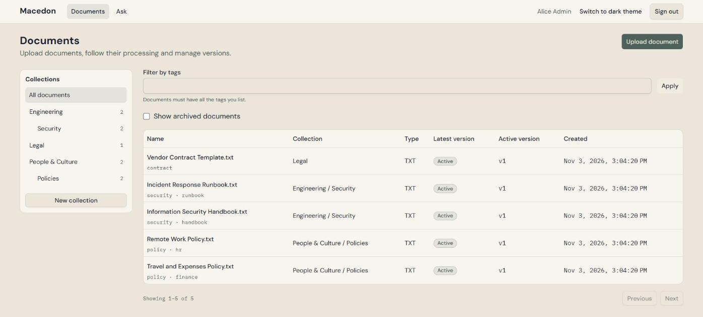
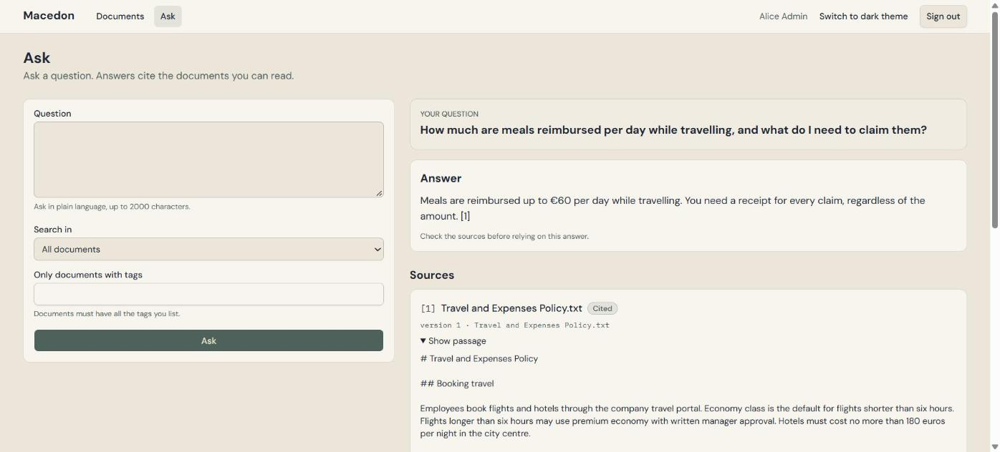
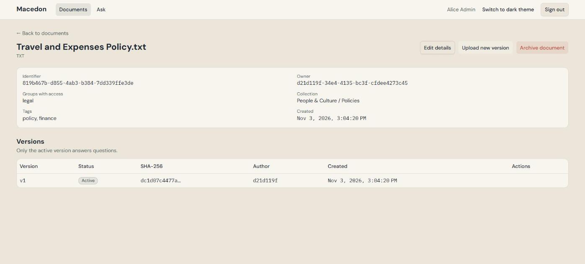
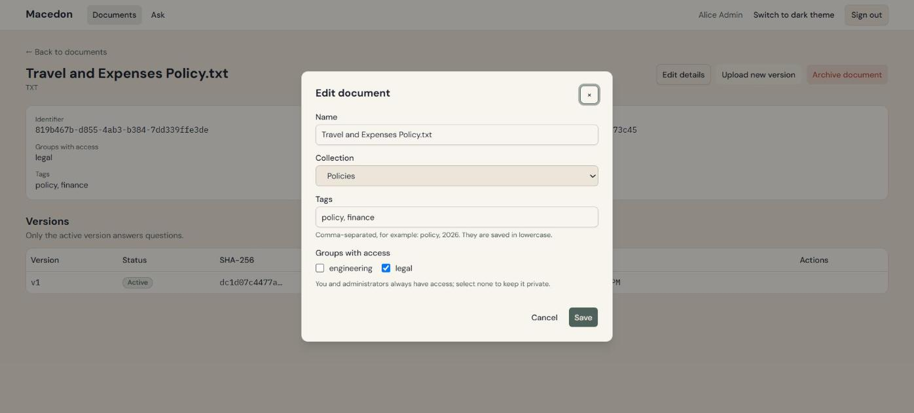
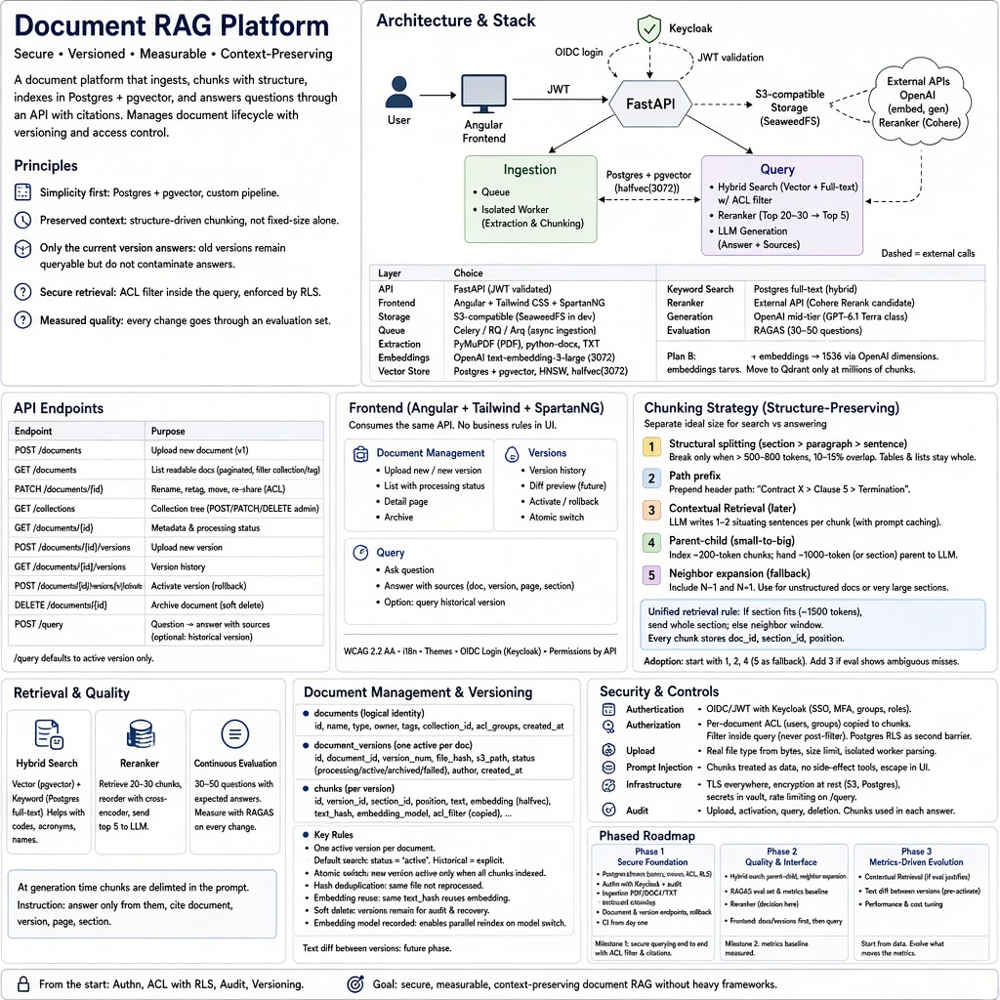

# Macedon

Document RAG platform: it receives documents, splits them into chunks while preserving context, indexes them in a vector store and answers questions through an API, citing the source document, version, page and section. It also manages document versions and access control. Open-source project (MIT).

See the full design in [docs/vision.md](docs/vision.md).

## About the name

"Macedon" comes from the idea of *divide and conquer*, which fits RAG well: documents are split into chunks so that each question can be answered by conquering only the relevant pieces. The phrase is often attributed, among other remote origins, to Philip II of Macedon.

## Warning: data is sent to external APIs

This project sends the content of documents to external APIs. All inference (embeddings, answer generation and reranking) is performed by third-party services, OpenAI by default. Nothing runs locally, and **there is no masking of personal or sensitive data**: content is sent as is.

Before using it with sensitive information, check with each configured provider:

- **Processing location:** the region where data is processed and whether data residency options exist.
- **Retention:** how long requests are stored and whether they may be used to train models.
- **Legal and contractual fit:** whether sending the data is compatible with data protection law (e.g. GDPR, LGPD) and your organization's obligations.

Anyone adopting the project can configure other providers, and the responsibility for this assessment lies with whoever operates it.

## What you get

- Upload PDF, DOCX and TXT files (the type is detected from the bytes). Ingestion is asynchronous: the upload returns at once and a worker extracts, chunks, embeds and indexes the file.
- Versioning: every upload of a changed file is a new version; a version only answers once it is fully indexed, and any older version can be activated again (rollback).
- Organization: a tree of collections (up to 4 levels) and free tags. Questions can be scoped to a collection (and everything below it), to one document, and to tags.
- Questions with cited answers: hybrid search (vector + keyword, fused by reciprocal rank), then an LLM answer with `[n]` citations and the passages it used. The keyword half folds accents and stems Portuguese words ("reembolsadas" finds "reembolso", "rescisao" finds "rescisão"); codes and identifiers are matched as written. Other languages are matched on exact words, and the vector search covers meaning in any language.
- Structure-aware PDF extraction: headings are found by font size and by labels such as "Cláusula 5.ª", "Artigo 10.º" or "Chapter IV" (so a citation names the clause, not the cover title), and page headers and footers repeated on every page are dropped. Tables come out as plain text.
- Access control: each document belongs to its owner and to the groups it is shared with. The rule is applied inside the search SQL and, as a second barrier, by Postgres Row-Level Security.
- An Angular web interface and a REST API (interactive docs at `/docs`).

## Screenshots

Sample documents of a fictional company, shown with the development user `alice`.

**Documents.** Collections on the left, tags and statuses in the list. Filter by collection (and everything below it) and by tags.



**Ask.** A question, an answer that cites its sources, and the passages the answer used. Questions can be limited to a collection, a document or tags.



**Document and versions.** Metadata, who it is shared with, and every version. Only the active version answers; any older one can be activated again.



**Sharing.** Choose the groups a document is shared with. The change applies to search at once.



## Architecture



The overview above summarizes the design in [docs/vision.md](docs/vision.md). It shows the target design: the reranker, for example, is a deferred decision and is not implemented yet.

| Piece | Technology |
| --- | --- |
| API | Python 3.13, FastAPI, SQLAlchemy (async), Alembic |
| Database | Postgres 17 with pgvector (`halfvec(3072)`, HNSW) and Row-Level Security |
| Search | Vector (cosine, HNSW) and Postgres full-text (unaccent + Portuguese stemming), fused by reciprocal rank; no reranker yet |
| Queue and worker | Redis and [Arq](https://arq-docs.helpmanual.io/) |
| File storage | Any S3-compatible store (SeaweedFS in the dev stack) |
| Identity | Any OIDC provider that issues JWTs (Keycloak in the dev stack) |
| Inference | OpenAI by default, behind own interfaces (`LLMProvider`, `EmbeddingProvider`) |
| Web | Angular, Tailwind CSS, SpartanNG |

The pipeline is written directly, without LangChain or LlamaIndex.

## Requirements

Install these first:

| Tool | Version | Used for |
| --- | --- | --- |
| [Docker](https://docs.docker.com/get-docker/) with Compose | recent | Postgres, Redis, S3 and Keycloak, and optionally the API, the worker and the web interface |
| [uv](https://docs.astral.sh/uv/getting-started/installation/) | recent | Python and the backend dependencies (it installs Python 3.13 for you); only to run the backend on your machine |
| [Node.js](https://nodejs.org/) | 24 | the web interface; only to run it on your machine |
| An [OpenAI API key](https://platform.openai.com/api-keys) | | embeddings and answers (usage is billed by OpenAI) |

To run everything in containers you only need Docker and the API key: see [Run everything in Docker](#run-everything-in-docker).

The commands below use a POSIX shell (Linux, macOS, Git Bash or WSL). On Windows PowerShell, replace `cp` with `Copy-Item`.

## Installation, step by step

### 1. Get the code

```bash
git clone https://github.com/jnascimentogcc/macedon.git
cd macedon
```

### 2. Start the infrastructure

```bash
docker compose up -d postgres redis s3 keycloak
```

This starts Postgres (with pgvector), Redis, an S3-compatible store and Keycloak, all bound to `127.0.0.1`. (This guide runs the API, the worker and the web interface on your machine; to run them in Docker too, skip to [Run everything in Docker](#run-everything-in-docker).) The first start downloads the images and Keycloak takes about a minute to be ready. Check with:

```bash
docker compose ps
```

All four services should be `Up` (Postgres `healthy`). Keycloak imports the `macedon` realm, with the sign-in client and the dev users, from [deploy/keycloak/macedon-realm.json](deploy/keycloak/macedon-realm.json) on its first start.

> The dev stack uses fixed, public passwords and is **not hardened**. Never expose it or reuse its credentials outside your machine.

### 3. Configure the backend

```bash
cd backend
cp .env.example .env
```

Open `backend/.env` and set:

```
MACEDON_OPENAI_API_KEY=sk-...
MACEDON_KNOWN_GROUPS=["engineering","legal"]
```

- `MACEDON_OPENAI_API_KEY` is required for ingestion and for questions.
- `MACEDON_KNOWN_GROUPS` is a JSON list of the groups a document can be shared with, besides the uploader's own groups. The upload form offers exactly these, and the API rejects other names. Add a name here whenever you create a group in your identity provider.

Every variable needs the `MACEDON_` prefix (a plain `OPENAI_API_KEY` is ignored). The other defaults already match the dev stack. `backend/.env` is ignored by git: never commit it.

### 4. Install dependencies and create the database schema

Still in `backend/`:

```bash
uv sync
uv run alembic upgrade head
```

The migrations create the tables, indexes, Row-Level Security policies and grants. The API connects as the `macedon_app` role, which is neither superuser nor table owner, so the policies apply to it.

### 5. Run the API

```bash
uv run uvicorn macedon.main:app --port 8000
```

Check it at <http://localhost:8000/health> (it answers `{"status":"ok"}`). Interactive API docs are at <http://localhost:8000/docs>. The storage bucket is created on first use.

### 6. Run the worker (second terminal)

The worker processes uploads in the background. Without it, documents stay in `processing`.

```bash
cd backend
uv run arq macedon.worker.WorkerSettings
```

Every 5 minutes it also re-enqueues versions that have been stuck in `processing` for more than 15 minutes.

### 7. Run the web interface (third terminal)

```bash
cd frontend
npm ci
npm start
```

Open <http://localhost:4200>. The interface expects the API on `http://127.0.0.1:8000` and Keycloak on `http://localhost:8080`; both are set in [frontend/src/app/config.ts](frontend/src/app/config.ts).

### Run everything in Docker

Instead of steps 4 to 7, the API, the ingestion worker and the web interface can run in containers next to the infrastructure. Do step 3 first (only `MACEDON_OPENAI_API_KEY` and `MACEDON_KNOWN_GROUPS` matter; `backend/.env` is optional, but without the key ingestion and questions fail), then, from the repository root:

```bash
docker compose up -d --build
```

A one-off `migrate` service creates the schema and exits; the API (<http://localhost:8000>), the worker and the web interface (<http://localhost:4200>) start after it. Inside the compose network the services reach each other by name, and those addresses override the ones in `backend/.env`. The API and Keycloak addresses used by the browser are compiled into the web image (see [frontend/src/app/config.ts](frontend/src/app/config.ts)), so rebuild it (`docker compose up -d --build web`) after changing them. Do not run the host API, worker or `npm start` at the same time: they use the same ports. Then go on to step 8.

### 8. Sign in and try it

Development users (defined in the Keycloak realm file):

| User | Password | Role | Group |
| --- | --- | --- | --- |
| `alice` | `alice-dev` | administrator | `engineering` |
| `bob` | `bob-dev` | regular user | `legal` |

1. Sign in as `alice`, go to **Documents** and upload a PDF, DOCX or TXT file. The status changes from `processing` to `active` when the worker finishes.
2. Open **Ask**, type a question and read the answer with its sources.
3. To see how access works, upload a document with no group selected, then sign in as `bob`: he does not see it. Upload another one shared with `legal` and he does.

## How access works

A user can read a document when at least one of these is true:

1. The user is an administrator (the `admin` role in the token).
2. The user is the owner, that is, the uploader.
3. One of the user's groups is among the groups the document is shared with.

Groups and roles come from the `groups` claim and the roles of the JWT; the API never calls the identity provider, so it can be swapped for any OIDC provider that issues them. Users and groups are managed in Keycloak (Admin Console at <http://localhost:8080>, user `admin`, password `admin` in the dev stack); a user must sign in again for changes to reach the token. Collections only organize documents: they never grant access.

## API keys for other applications

Another application can call the API with an API key instead of a signed-in user. Only administrators create keys, with `POST /api-keys` (an administrator's bearer token):

```json
{ "name": "reporting", "groups": ["engineering"], "scopes": ["read"], "expires_in_days": 90 }
```

The response carries the key (`mcd_...`) **once**; only a hash is stored, so a lost key is revoked and replaced, never recovered. The application sends it like a token: `Authorization: Bearer mcd_...`.

- A key is its own identity (`key:<id>`) with the groups chosen at creation, so the access rules above apply to it unchanged. It is never an administrator and cannot manage keys.
- Groups can only be ones in `MACEDON_KNOWN_GROUPS` or the creator's own.
- Scopes: `read` (list and read documents, `POST /query`) and `write` (upload, new versions, edits, archive, rollback). Default: `read`.
- A key always expires: 90 days by default (`MACEDON_API_KEY_DEFAULT_DAYS`), 365 at most (`MACEDON_API_KEY_MAX_DAYS`).
- `GET /api-keys` lists keys (name, prefix, groups, scopes, expiry, last use); `DELETE /api-keys/{id}` revokes one at once. Creation and revocation are audited, and so is every action a key performs, under `key:<id>`.
- Queries by a key count against their own rate limit, apart from any user's.

The guide for the applications that use a key (calls, errors, handling and rotation) is [docs/features/api-keys.md](docs/features/api-keys.md).

Administrators manage keys in the web interface under **API keys** (the link appears only for them): create a key, copy it from the one-time dialog, and revoke it.

## Configuration

All settings are environment variables with the `MACEDON_` prefix, read from `backend/.env` (see [backend/src/macedon/config.py](backend/src/macedon/config.py) for the full list). The main ones:

| Variable | Purpose | Default |
| --- | --- | --- |
| `MACEDON_OPENAI_API_KEY` | OpenAI key (required) | none |
| `MACEDON_KNOWN_GROUPS` | JSON list of shareable groups | `[]` |
| `MACEDON_API_KEY_DEFAULT_DAYS`, `MACEDON_API_KEY_MAX_DAYS` | default and maximum lifetime of an API key | `90`, `365` |
| `MACEDON_DATABASE_URL` | database URL used by the API (`macedon_app` role) | dev stack |
| `MACEDON_MIGRATION_DATABASE_URL` | database URL used by migrations (schema owner) | dev stack |
| `MACEDON_REDIS_URL` | queue | `redis://127.0.0.1:6379` |
| `MACEDON_S3_*` | endpoint, bucket and keys of the file store | dev stack |
| `MACEDON_OIDC_ISSUER`, `MACEDON_OIDC_AUDIENCE`, `MACEDON_OIDC_JWKS_URL` | token validation | dev Keycloak |
| `MACEDON_CORS_ORIGINS` | JSON list of browser origins allowed to call the API | `["http://localhost:4200","http://127.0.0.1:4200"]` |
| `MACEDON_LLM_MODEL`, `MACEDON_EMBEDDING_MODEL` | models (the embedding model and its dimension are fixed once documents are indexed) | see `config.py` |
| `MACEDON_QUERY_RATE_LIMIT_PER_MINUTE` | per-user limit on questions | `30` |
| `MACEDON_MAX_UPLOAD_BYTES` | upload size limit | 50 MiB |

Use `127.0.0.1` rather than `localhost` for Postgres on Windows: `localhost` adds about two seconds per connection. The browser can open the web interface at `http://localhost:4200` or `http://127.0.0.1:4200`; the Keycloak client and the API's CORS setting accept both and nothing else.

## Development

Backend (from `backend/`):

```bash
uv run pytest                                   # tests (integration tests use the dev Postgres)
uv run ruff check . && uv run ruff format --check .
uv run mypy src tests
```

> The integration tests truncate the tables of the dev database. Do not run them against data you want to keep.

Frontend (from `frontend/`):

```bash
npm test
npm run build
```

CI runs these checks on every pull request (`.github/workflows`). Tests use mocked inference providers, so they need no API key.

The retrieval and answer-quality evaluations call paid APIs, truncate the dev database and are run by hand (from `backend/`). Any change to chunking, extraction, the embedding model or the search must be measured with them; see [backend/eval/README.md](backend/eval/README.md) for the metrics and results.

```bash
uv run python eval/run.py                  # English synthetic corpus: 34 questions, scoped and access-control checks
uv run python eval/run_pt.py               # Portuguese set: accents, inflections, identifiers
uv run python eval/run_real.py --dir <dir> # real PDFs you provide (the questions in corpus_real.py target two public tender documents)
```

## Troubleshooting

- **Documents stay in `processing`:** the worker is not running, or `MACEDON_OPENAI_API_KEY` is missing or invalid. Check the worker terminal.
- **Sign-in fails or loops:** Keycloak may still be starting (`docker compose logs keycloak`), or the page is not served from `http://localhost:4200` or `http://127.0.0.1:4200` (any other address, such as your machine's name or IP, is rejected by Keycloak with "Invalid parameter: redirect_uri"). If the realm already existed before `127.0.0.1` was added to the realm file, the import is not repeated: add `http://127.0.0.1:4200/*` as a valid redirect URI and `http://127.0.0.1:4200` as a web origin on the `macedon-web` client in the Keycloak admin console (<http://localhost:8080>, `admin` / `admin`), or run `docker compose down -v` to start from scratch.
- **The upload form lists no groups, or a group is rejected:** set `MACEDON_KNOWN_GROUPS` as a JSON list and restart the API.
- **A user cannot see a document:** see [How access works](#how-access-works). The document must be owned by the user or shared with one of their groups, and group changes only reach the token after signing in again.
- **After updating the code:** apply new migrations before starting the API and the worker, with `uv run alembic upgrade head` (from `backend/`) or, in Docker, `docker compose up -d --build`, whose `migrate` service does it. Migration 0004 rebuilds the keyword index with the Portuguese configuration, which can take a while on a large database; documents extracted before the PDF changes keep their old structure until a new version is uploaded.
- **Start from scratch:** `docker compose down -v` deletes the dev data (database, files, Keycloak state); then repeat from step 2.

## Documentation

- [docs/vision.md](docs/vision.md): design, decisions and roadmap.
- [docs/ui-spec.md](docs/ui-spec.md): design system of the web interface.
- [docs/features/documents-ui.md](docs/features/documents-ui.md): screens and flows.
- [docs/features/api-keys.md](docs/features/api-keys.md): API keys, and a guide for applications that call the API with one.
- [backend/eval/README.md](backend/eval/README.md): evaluation set and metrics.
- [CLAUDE.md](CLAUDE.md): guidance for AI coding assistants working in this repository.

## License

[MIT](LICENSE)
