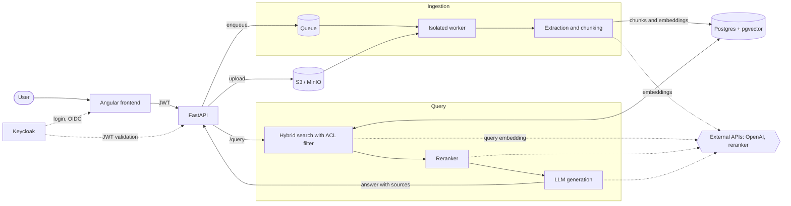

# Vision — Document RAG Platform

Nov 2, 2026 · @Jorge Nascimento

## Overview

The platform receives documents, splits them into chunks without losing context, indexes them in a vector store and answers questions through an API, always citing the source document and version. Besides RAG, it manages the document lifecycle with versioning and access control.

**Principles**

- **Simplicity first:** Postgres with pgvector before a dedicated vector database; a custom pipeline instead of heavy frameworks.
- **Preserved context:** chunking driven by document structure, never by fixed size alone.
- **Only the current version answers:** old versions do not contaminate answers, but remain queryable.
- **Secure retrieval:** each user only retrieves chunks from documents they are allowed to see.
- **Measured quality:** every change to chunking or models goes through an evaluation set.

## Functional scope and API

The API covers three fronts: asynchronous ingestion, querying with sources, and version management. Upload responds immediately and processing runs in the background.

| Endpoint | Purpose |
| --- | --- |
| `POST /documents` | Uploads a new document (creates version 1) |
| `GET /documents/{id}` | Returns metadata and processing status |
| `POST /documents/{id}/versions` | Uploads a new version of the document |
| `GET /documents/{id}/versions` | Lists the version history |
| `POST /documents/{id}/versions/{v}/activate` | Activates a version (including rollback) |
| `DELETE /documents/{id}` | Archives the document (soft delete) |
| `POST /query` | Takes the question and returns the answer with sources (document, version, page, section) |

`/query` accepts an optional parameter to query a specific historical version; by default, only the active version is searched.

## Frontend

The platform will have a web frontend for document management and querying, consuming the same API (no business or access rules live in the frontend). Scope:

- **Document management:** upload of new documents and new versions, list with processing status, document detail and archiving.
- **Versions:** version history, activation and rollback.
- **Query:** question-and-answer screen with sources (document, version, page and section) and an option to query a historical version.

Stack: Angular, Tailwind CSS and SpartanNG. The design system, accessibility (WCAG 2.2 AA), i18n and themes follow [ui-spec.md](ui-spec.md); the pages, flows and permissions of each feature live in separate feature specs. Login uses OIDC with Keycloak (Authorization Code with PKCE), and what each user sees remains decided by the API.

## Architecture and stack

The foundation is Python with FastAPI and Postgres with pgvector, which avoids maintaining a separate vector database at the start. Ingestion runs in queue-fed workers; querying runs directly in the API.

Ingestion stores the original in S3/MinIO and, through the queue and an isolated worker, writes chunks and embeddings to Postgres; the query searches there with the ACL filter, reranks and generates the answer. Dashed lines are calls to external APIs and to Keycloak.

| Layer | Choice | Notes |
| --- | --- | --- |
| API | FastAPI | Validates the JWT on every request |
| Frontend | Angular, Tailwind CSS and SpartanNG | SPA that consumes the API; design system in `ui-spec.md` |
| Original file storage | S3 or MinIO | One object per version |
| Ingestion queue | Celery, RQ or Arq | Upload does not block |
| Text extraction | Docling (structured PDF), PyMuPDF, python-docx; TXT read directly | Docling preserves headings and tables. Initial formats: PDF, DOCX and TXT |
| Embeddings | OpenAI API: `text-embedding-3-large` | Model fixed from the start; changing it requires reindexing |
| Vector store | Postgres + pgvector, HNSW index | Estimated volume: ~5,000 documents per year (roughly hundreds of thousands of chunks), well within pgvector's capacity. `text-embedding-3-large` produces 3072 dimensions and pgvector's HNSW indexes `vector` only up to 2000; the decision is to store embeddings as `halfvec(3072)` (HNSW up to 4000 dimensions), without reducing quality. Plan B if performance becomes a problem: reduce to 1536 through OpenAI's `dimensions` parameter. Move to Qdrant only with millions of chunks or heavy filtering |
| Keyword search | Postgres full-text | Basis of hybrid search |
| Reranker | To be defined (external API) | Reorders the top 20–30; OpenAI does not offer a reranker. Candidate: Cohere Rerank |
| Generation | OpenAI, mid-tier (e.g. GPT-6.1 Terra) | Answers citing the sources; mini tier (e.g. GPT-6 Luna) for Contextual Retrieval |
| Evaluation | RAGAS | Set of 30–50 questions |

**External providers and provider switching.** All inference (embeddings, generation and reranking) uses external APIs; nothing runs locally. OpenAI is the default provider, but since the project is open source, anyone adopting it can use others. Generation, embeddings and reranking sit behind small own interfaces (`LLMProvider`, `EmbeddingProvider`, `Reranker`), selected by configuration (provider, model, key). Because each chunk records its `embedding_model`, switching the embeddings provider is handled by reindexing in parallel. The models named above reflect the [OpenAI models page](https://developers.openai.com/api/docs/models/all) as of Nov 2026 and must be revalidated before being fixed.

LangChain and LlamaIndex help with prototyping, but the pipeline is simple enough to be written directly, with less abstraction and more control.

## Chunking strategy

Fixed-size chunks lose context for two reasons: they cut ideas in the middle and leave each piece without knowing which document or section it came from. The strategy combines five techniques, separating the ideal size for *searching* from the ideal size for *answering*.

1. **Structural splitting.** Split by the document hierarchy: section, paragraph, sentence. Only break a paragraph when it exceeds the limit (500–800 tokens, 10–15% overlap). Tables and lists stay whole.
2. **Path prefix.** Before embedding, add a header such as "Contract X > Clause 5 > Termination". This resolves ambiguous chunks such as "the term will be 30 days".
3. **Contextual Retrieval.** A cheap LLM reads the document and writes 1–2 sentences situating each chunk; the text is prepended to the chunk before embedding and keyword indexing. Anthropic reported about 49% fewer retrieval failures, and about 67% with a reranker. Prompt caching of the document reduces the cost.
4. **Parent-child (small-to-big).** Index small chunks (\~200 tokens), precise for search, and hand the LLM the larger parent block (the section or \~1000 tokens).
5. **Neighbor expansion.** When chunk N is retrieved, include N−1 and N+1. Replaces parent-child for unstructured documents (running text, transcripts, OCR) and bounds the context when the section is too large.

**Unified retrieval rule:** each chunk stores `doc_id`, `section_id` and `position`. If the section fits the limit (\~1500 tokens), the whole section is sent; otherwise, the neighbor window. A single pipeline serves both structured and unstructured documents.

**Adoption order:** start with items 1, 2 and 4 (with 5 as fallback), which are cheap and cover most of the problem. Add 3 if evaluation shows ambiguous chunks being missed. Semantic chunking by embedding similarity is out: benchmark gains are inconsistent and the cost is higher.

## Retrieval and quality

Three practices concentrate the largest quality gains after chunking.

- **Hybrid search:** combine vector search with keyword search (Postgres full-text). It helps a lot with codes, acronyms and proper names.
- **Reranker:** retrieve 20–30 chunks and reorder them with a cross-encoder before sending the best 5 to the LLM.
- **Continuous evaluation:** keep 30–50 questions with expected answers and measure with RAGAS on every change to chunking, embedding model or reranker.

At generation time, the chunks enter the prompt delimited, and the LLM is instructed to answer only from them, citing document, version, page and section.

## Document management and versioning

Each document has several versions and only one active; chunks belong to the version, not to the document. This prevents outdated passages from mixing into answers.

| Table | Main content |
| --- | --- |
| `documents` | Logical identity: name, type, owner, tags, ACL |
| `document_versions` | Version number, SHA-256 hash of the file, S3 path, status (`processing`, `active`, `archived`, `failed`), author, date |
| `chunks` | Text, embedding, `version_id`, `section_id`, `position`, text hash, `embedding_model`, permission metadata |

**Rules**

1. **One active version per document.** The default search filters `status = 'active'`; historical versions only with an explicit parameter.
2. **Atomic switch.** A new version only becomes active when all its chunks are indexed; until then, the previous one keeps answering.
3. **Hash deduplication.** Re-uploading the same file is not reprocessed.
4. **Embedding reuse.** Chunks whose text hash already exists copy the embedding instead of recomputing it.
5. **Soft delete.** Deleting archives the versions, preserving audit and recovery.
6. **Embedding model recorded.** Allows reindexing in parallel when switching models, without taking search down.

A text diff between versions, to review before activating, is left for a later phase.

## Security

The most important control is ensuring that each user only retrieves chunks from documents they are allowed to see, with the filter applied inside the vector query itself.

| Area | Control |
| --- | --- |
| Authentication | OIDC/JWT with **Keycloak** (open source, self-hostable) as the default provider. It handles login, SSO, MFA, users, groups and claims (groups, roles). The API only validates the JWT; since it is standard OIDC, another provider can replace it without changing the application |
| Authorization | Keycloak tells who the user is and which groups they belong to; the access decision on documents stays in the platform: per-document ACL (users, groups) copied to the chunks; filter in the query, never post-filter; Postgres Row-Level Security as a second barrier |
| Upload | Real file type validated from the bytes, size limit, parsing in an isolated worker |
| Prompt injection | Chunks delimited in the prompt and treated as data; no tools with side effects in the query flow; answer escaped in the frontend |
| Infrastructure | TLS everywhere, encryption at rest (S3 and Postgres), secrets in a vault, per-user rate limiting on `/query` |
| Audit | Record of upload, activation, query and deletion, including the chunks used in each answer |

Authentication, authorization with RLS and audit are a priority from the start: they are the most expensive controls to add once the system is in production.

## Phased roadmap

Phase 1 concentrates what is expensive to add later (authentication, ACL with RLS, audit and versioning). Phase 2 only starts with secure querying working end to end, and phase 3 starts from a metrics baseline to justify each evolution.

### Phase 1: secure foundation

- Postgres schema (`halfvec(3072)`, versions, ACL) with Row-Level Security.
- Authentication with Keycloak and audit.
- Ingestion of PDF, DOCX and TXT in an isolated worker, with structural chunking and path prefix.
- Document and version endpoints, with atomic switch and rollback.
- CI from the first commit of code.

**Milestone 1:** secure querying working end to end, with `/query` filtering by ACL and citing sources.

### Phase 2: quality and interface

- Hybrid search, parent-child and neighbor expansion.
- RAGAS evaluation set and metrics baseline.
- Reranker (deferred decision, taken here).
- Frontend: document and version management first, then the query screen.

**Milestone 2:** metrics baseline measured.

### Phase 3: metrics-driven evolution

- Contextual Retrieval, only if evaluation shows ambiguous chunks being missed.
- Text diff between versions, to review before activating.
- Performance and cost tuning.

## Open questions

None at the moment.

## Deferred decisions

- **Reranker service:** will be chosen later (external API; OpenAI does not offer one). Candidate: Cohere Rerank. Since the reranker sits behind the `Reranker` interface, the choice does not affect the rest of the pipeline.
